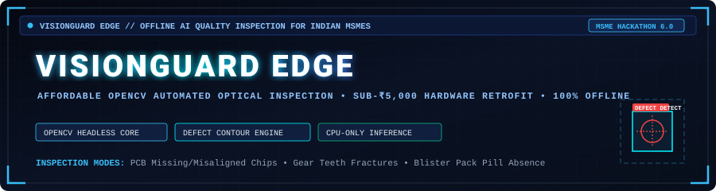
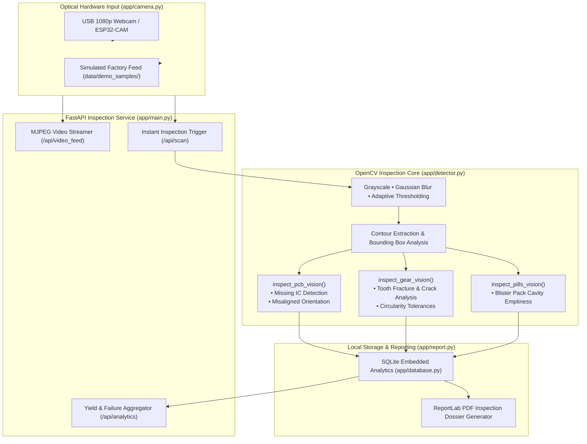

<div align="center">



<br/>

[](https://my.msme.gov.in/)
[](https://python.org)
[](https://fastapi.tiangolo.com)
[](https://opencv.org)
[](https://github.com/RatanPandey-007/VisionGuard)

</div>

---

## 🏭 1. Problem Statement & Industrial Context

Micro, Small, and Medium Enterprises (MSMEs) in India contribute over **30% of national GDP** and **45% of manufacturing output**, yet the vast majority remain reliant on manual visual inspection for quality control. 

* **High Capital Barrier**: Commercial Automated Optical Inspection (AOI) machines cost between **₹5 Lakhs and ₹15 Lakhs**, requiring high-end dedicated GPUs, proprietary lighting enclosures, and vendor lock-in.
* **Connectivity & IP Security**: Small factory floors in Tier-2/Tier-3 industrial corridors often suffer from erratic internet connectivity. Factory owners are understandably reluctant to stream proprietary assembly lines and yield defect rates to public cloud servers.
* **Fatigue & Escape Rates**: Human inspectors on rapid assembly lines experience visual fatigue after 20 minutes, leading to defect escape rates between 12% and 25%.

**VisionGuard Edge** solves this dilemma through a **software-first retrofit approach**. By pairing low-cost optical hardware (USB webcams, industrial endoscopes, or ₹800 ESP32-CAM modules) with CPU-optimized OpenCV computer vision pipelines, it transforms standard factory laptops into real-time quality inspection stations for **under ₹5,000 total hardware investment**.

---

## 🔬 2. Real System Architecture



---

## 🎯 3. Verified Inspection Modes & Defect Detection

VisionGuard Edge provides deterministic, explainable computer vision algorithms calibrated for three widespread MSME manufacturing categories:

| Manufacturing Domain | Inspection Algorithm | Detectable Anomalies | Verification Test Samples |
|---|---|---|---|
| **Printed Circuit Boards (PCBs)** | Contour centroid matching & bounding box ratio checks | Missing surface-mount components, misaligned IC pins, track bridges | `data/demo_samples/01_perfect_pcb_a.png`<br/>`data/demo_samples/03_defect_missing_chip.png`<br/>`data/demo_samples/04_defect_misaligned_chip.png` |
| **Machined Gears & Mechanical Components** | Convex hull variance, perimeter circularity, and edge continuity | Tooth fractures, radial hairline cracks, dimensional eccentricities | `data/demo_samples/05_perfect_gear.png`<br/>`data/demo_samples/06_defect_gear_crack.png`<br/>`data/demo_samples/07_defect_gear_dimension.png` |
| **Pharmaceutical Packaging** | Circular Hough Transform & grid cavity area occupancy | Missing tablets in blister packaging, broken pills, partial fills | `data/demo_samples/08_perfect_pills.png`<br/>`data/demo_samples/09_defect_pills_missing.png` |

---

## 🛠️ 4. Technology Stack

* **Backend & API Framework**: Python 3.10+, FastAPI, Uvicorn (ASGI).
* **Computer Vision**: OpenCV Headless (`opencv-python-headless>=4.8.0`), NumPy, Pillow.
* **Audit & Document Generation**: ReportLab 4.0 (shift summary PDF reports), Matplotlib (yield distribution charts).
* **Frontend Web HUD**: Vanilla ES6+ JavaScript, CSS3 dark terminal interface, HTML5 Canvas overlay for real-time bounding box inspection feeds.
* **Storage**: Embedded SQLite (100% on-premises, zero external database daemon required).

---

## 📡 5. Verified API Endpoints

| Method | Endpoint | Description |
|---|---|---|
| `GET` | `/` | Web HUD dashboard with live camera feed, inspection triggers, and shift stats |
| `GET` | `/api/video_feed` | Low-latency MJPEG video feed streamed directly from camera or synthetic loader |
| `POST` | `/api/scan` | Executes instantaneous algorithmic defect inspection on the current optical frame |
| `GET` | `/api/cameras` | Probes and lists all physically connected USB / UVC / IP camera indices |
| `GET` | `/api/analytics` | Returns shift statistics (total scanned, pass count, defect breakdown, yield rate) |
| `POST` | `/api/reports/generate` | Compiles a formatted PDF shift summary report with timestamped defect captures |
| `GET` | `/api/history` | Fetches historical log of timestamped pass/fail inspections |
| `POST` | `/api/config` | Updates inspection thresholds, sensitivity margins, and active part profiles |

---

## 🚀 6. Installation & Execution

### Prerequisites
* Python 3.10 or higher
* Standard USB Webcam (or integrated laptop camera)

### 1. Clone & Setup
```bash
git clone https://github.com/RatanPandey-007/VisionGuard.git
cd VisionGuard

# Setup virtual environment
python -m venv venv
.\venv\Scripts\Activate.ps1  # Windows PowerShell
# source venv/bin/activate    # Linux / macOS
```

### 2. Install Dependencies
```bash
pip install --upgrade pip
pip install -r requirements.txt
```

### 3. Run the Application
```bash
python run.py
```
Open your browser and visit: **`http://localhost:8000`**

*(Note: The server listens on port **8000** by default via Uvicorn).*

---

## ⚠️ 7. Operational Limitations & Edge Considerations

> [!NOTE]
> * **Planar Alignment**: The deterministic contour algorithms assume consistent lighting and top-down perpendicular camera mounting ($\pm 15^\circ$ angle tolerance).
> * **CPU Optimization**: Inferences require approximately **18ms to 45ms per frame** on a modern multi-core Intel/AMD CPU, comfortably satisfying assembly speeds up to 120 parts per minute without dedicated GPU accelerators.

---

## 🗺️ 8. Roadmap

- [x] CPU-only contour inspection for PCBs, gears, and pharmaceutical blister packs.
- [x] Zero-dependency local SQLite shift analytics and yield tracking.
- [x] Automated ReportLab PDF shift quality report compilation.
- [ ] Direct MQTT / Modbus protocol adapter for PLC ejection arm triggering.
- [ ] Lightweight Edge TPU (Coral / Hailo-8) accelerator integration for micro-second inferences.

---

## 🏷️ Repository Topics
`computer-vision` • `opencv` • `fastapi` • `msme` • `quality-inspection` • `edge-ai` • `python` • `manufacturing` • `defect-detection` • `air-gapped`
